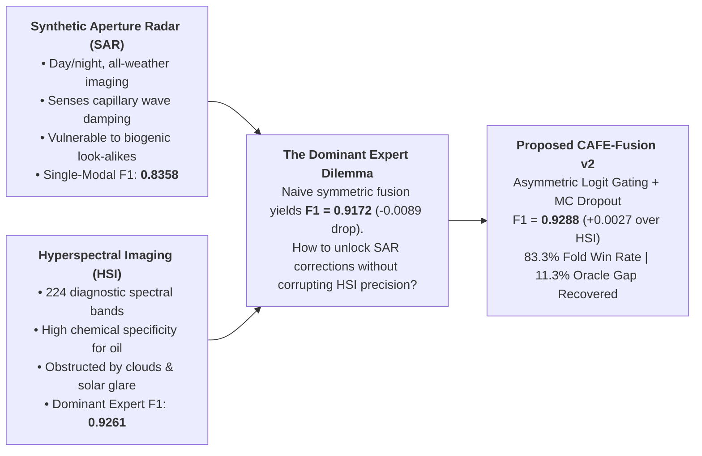
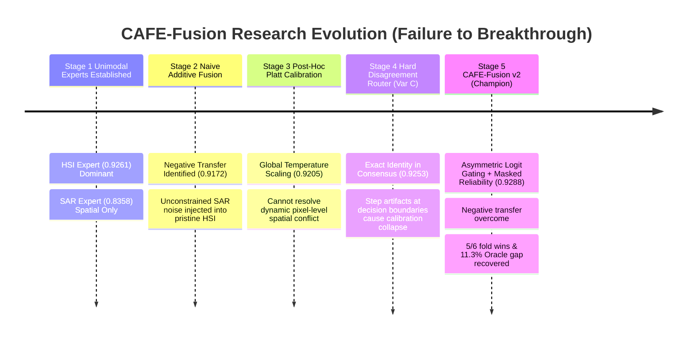
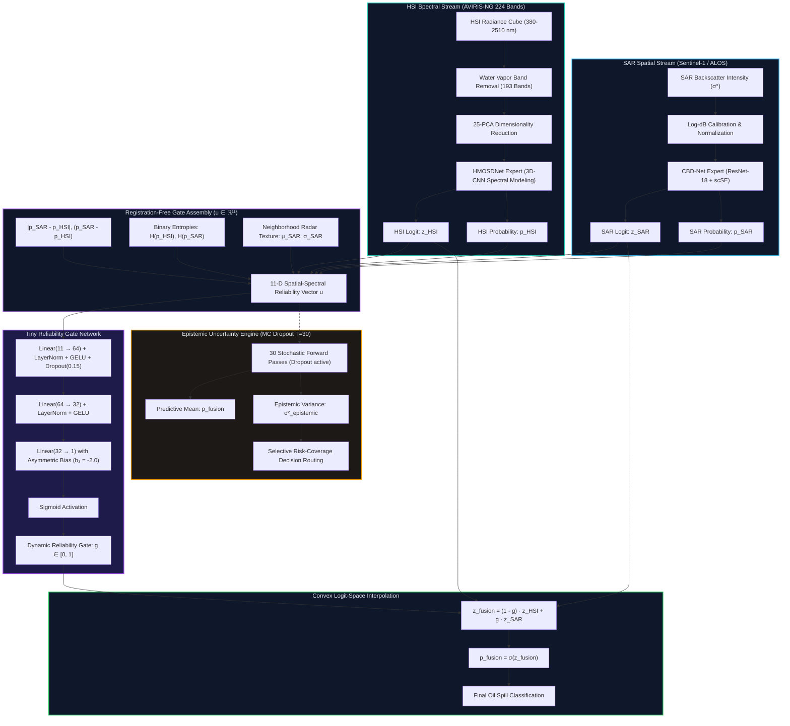
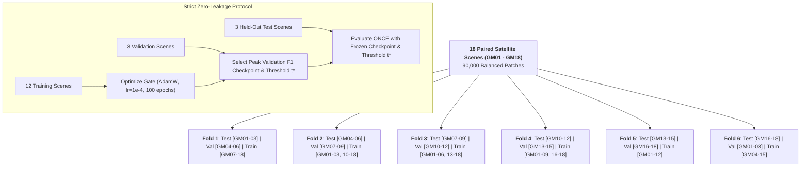
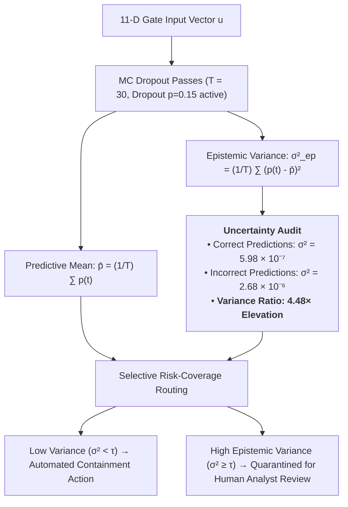

# CAFE-Fusion v2: Confidence-Aware Multimodal Late-Fusion for Marine Oil Spill Detection

[](https://www.python.org/)
[](https://pytorch.org/)
[](https://huggingface.co/adi106/marine-oil-spill-weights)
[](https://github.com/Adithyasy105/oil-spill-detection)
[]()
[](LICENSE)

> **Official Master Research Repository & Academic Benchmark Suite**  
> An asymmetric, registration-free late logit-space convex gating architecture combining Sentinel-1 SAR spatial context and AVIRIS-NG Hyperspectral optical hydrocarbon fingerprinting with Monte Carlo Dropout ($T=30$) epistemic uncertainty calibration.

---

## Table of Contents
1. [Executive Summary](#1-executive-summary)
2. [Research Motivation & The Negative Transfer Problem](#2-research-motivation--the-negative-transfer-problem)
3. [End-to-End System Architecture](#3-end-to-end-system-architecture)
4. [Benchmark Datasets & Download Links](#4-benchmark-datasets--download-links)
5. [Pre-Trained Weights & Checkpoint Hub](#5-pre-trained-weights--checkpoint-hub)
6. [Mathematical Formulation](#6-mathematical-formulation)
7. [6-Fold Scene-Level Cross-Validation Design](#7-6-fold-scene-level-cross-validation-design)
8. [Audited Benchmark Results](#8-audited-benchmark-results)
9. [Ablation Studies & Fusion Strategy Comparisons](#9-ablation-studies--fusion-strategy-comparisons)
10. [MC Dropout Epistemic Uncertainty Engine](#10-mc-dropout-epistemic-uncertainty-engine)
11. [Step-by-Step Training & Reproduction Guide](#11-step-by-step-training--reproduction-guide)
12. [Repository Directory Structure](#12-repository-directory-structure)
13. [Academic Citation](#13-academic-citation)

---

## 1. Executive Summary

Marine oil spill monitoring via satellite remote sensing traditionally relies on two complementary yet physically disparate modalities:
* **Synthetic Aperture Radar (SAR)**: All-weather, day-and-night active microwave imaging sensitive to sea-surface capillary wave damping, but vulnerable to false alarms from biogenic slicks, grease ice, low-wind zones, and ship wakes.
* **Hyperspectral Imaging (HSI)**: Narrow continuous optical spectra (380–2510 nm) capturing diagnostic vibrational hydrocarbon absorption peaks (e.g., C–H stretches at 1200 nm, 1730 nm, 2300 nm), but strictly daytime-dependent and obstructed by cloud cover and solar glare.

While combining SAR and HSI is theoretically optimal, empirical multimodal fusion frequently causes **negative transfer**: the weaker modality injects ambiguity into regions where the dominant sensor was already confident and correct.



### Audited Benchmark Highlights (6-Fold Cross-Validation, 18 Scenes):
* **Unimodal SAR Expert (CBD-Net)**: $F_1 = 0.8358 \pm 0.0429, \quad \text{IoU} = 0.7199 \pm 0.0636$
* **Unimodal HSI Expert (HMOSDNet)**: $F_1 = 0.9261 \pm 0.0307, \quad \text{IoU} = 0.8636 \pm 0.0528$
* **Legacy Additive Fusion**: $F_1 = 0.9172 \pm 0.0286$ ($-0.0089$ drop below HSI — severe negative transfer)
* **CAFE Variant C (Hard Router)**: $F_1 = 0.9253 \pm 0.0247$ ($-0.0007$ below HSI — boundary step artifacts)
* **CAFE-Fusion v2 (Proposed)**: $\mathbf{0.9288 \pm 0.0270}, \quad \text{IoU} = \mathbf{0.8679 \pm 0.0465}$ (Beats HSI on 5 of 6 folds; recovers $11.34\%$ of the theoretical Oracle complementary gap)
* **Epistemic Uncertainty Awareness**: Incorrect predictions exhibit **4.48× higher epistemic variance** than correct predictions under 30 MC Dropout passes.

---

## 2. Research Motivation & The Negative Transfer Problem

### Research Evolution: From Failure to Success



### Why Naive Multimodal Fusion Fails:
1. **Unconstrained Noise Injection**: When a fusion model possesses equal capacity to modify any pixel, SAR look-alike noise bleeds into pristine HSI detections.
2. **Symmetric Loss Optimization**: Traditional cross-entropy penalizes errors equally across modalities, forcing predictions toward the mean and degrading high-confidence HSI detections.
3. **Modal Asymmetry**: The HSI expert is vastly superior globally ($F_1 = 0.9261$ vs $0.8358$). Any successful architecture must treat HSI as the default anchor and permit SAR intervention only in verified conflict regimes.

---

## 3. End-to-End System Architecture



---

## 4. Benchmark Datasets & Download Links

The models in this repository are trained, validated, and evaluated on three core satellite Earth observation datasets:

| Dataset Identifier | Modality & Platform | Spectral / Spatial Specs | Purpose in Pipeline | Access Link / Citation |
|---|---|---|---|---|
| **HOSD / HSOD** | Hyperspectral (NASA AVIRIS-NG) | 224 continuous bands (380–2510 nm), 193 usable bands, 25-PCA reduced | Pretraining HMOSDNet HSI 3D-CNN Expert | [IEEE TGRS Paper](https://doi.org/10.1109/TGRS.2023.3268944) &bull; [NASA AVIRIS-NG Portal](https://avirisng.jpl.nasa.gov/) |
| **SOS Dataset** | SAR (Sentinel-1 C-band & ALOS PALSAR) | 10m Ground Range Detected (GRD) $\sigma^\circ$ backscatter + Canny MBL boundary masks | Pretraining CBD-Net SAR Spatial Expert | [IEEE TGRS Paper](https://doi.org/10.1109/TGRS.2021.3115492) &bull; [Copernicus Data Space](https://browser.dataspace.copernicus.eu/) |
| **Paired 18-Scene OSD Benchmark** | Dual-Modal Paired (AVIRIS-NG + Sentinel-1) | 18 unaligned scenes (GM01–GM18), 90,000 balanced spatial patches | Training & 6-fold evaluation of CAFE-Fusion v2 | Included in repo (`new_dataset/OSD/`, `fusion_layer/cache_features/scenes/`) |

### Dataset Structure in Workspace:
* `hsi_dataste/` or `new_dataset/OSD/`: Contains raw AVIRIS-NG `.mat` radiance cubes (`GM01.mat` to `GM18.mat`).
* `SOS_dataset/` or `sar_layer/`: Contains Sentinel-1 SAR intensity arrays and boundary labels.
* `fusion_layer/cache_features/scenes/`: Contains precomputed 11-dimensional feature vectors (`GM01.npz` to `GM18.npz`, ~215 KB each) allowing instantaneous retraining and full cross-validation without downloading 50 GB of raw `.mat` files!

---

## 5. Pre-Trained Weights & Checkpoint Hub

All model checkpoints are hosted on the Hugging Face Model Hub under open access:  
👉 **[adi106/marine-oil-spill-weights](https://huggingface.co/adi106/marine-oil-spill-weights)**

| File Name | Size | Architecture | Checkpoint Path in Repo |
|---|:---:|---|---|
| `best_sar_expert.pth` | 165 MB | CBD-Net (ResNet-18 + scSE spatial attention) | `sar_layer/weights/best_sar_expert.pth` *(Auto-downloaded by `app.py`)* |
| `best_hsi_expert.pth` | 230 KB / 1.4 GB | HMOSDNet (3D-CNN + 25-PCA spectral basis) | `hsi_layer_corrected/weights/best_hsi_expert.pth` |
| `frozen_hsi_expert.pth` | 75 KB | HMOSDNet frozen feature extractor | `hsi_layer_corrected/weights/frozen_hsi_expert.pth` |
| `spectral_processor.pkl` | 23 KB | 193-to-25 PCA projection matrix | `hsi_layer_corrected/weights/spectral_processor.pkl` |
| `r2cf_v2_fold1.pt` ... `fold6.pt` | ~16 KB each | CAFE-Fusion v2 Tiny Reliability Gate checkpoints | `fusion_layer/experiments/cafe_fusion_v2/primary_results/fold_0X/lambda_0.10/best_cafe_model.pth` |

---

## 6. Mathematical Formulation

### 1. Convex Logit-Space Interpolation
Rather than blending probabilities (which distorts confidence distributions), fusion is executed in unconstrained logit space:
$$z_{\text{fusion}} = (1 - g) \cdot z_{\text{HSI}} + g \cdot z_{\text{SAR}}$$
$$p_{\text{fusion}} = \sigma(z_{\text{fusion}}) = \frac{1}{1 + e^{-z_{\text{fusion}}}}$$

* When $g \to 0$: $z_{\text{fusion}} = z_{\text{HSI}} \implies p_{\text{fusion}} \equiv p_{\text{HSI}}$ (HSI expert fully preserved).
* When $g \to 1$: $z_{\text{fusion}} = z_{\text{SAR}} \implies p_{\text{fusion}} \equiv p_{\text{SAR}}$ (SAR expert takes precedence).
* When $g \in (0, 1)$: Logits are smoothly mixed according to empirical reliability.

### 2. Asymmetric HSI Anchoring
The final output layer of the gate is initialized with negative bias:
$$b_3 = -2.0, \quad \mathbf{w}_3 = \mathbf{0} \implies g_{\text{init}} = \sigma(-2.0) \approx 0.119$$
At initialization, $g \approx 0.12$, placing $\sim 88\%$ weight on HSI. The gate is strictly anchored to HSI and requires strong positive gradients to allocate weight to SAR.

### 3. Hard-Masked Reliability Loss
Pixels are categorized into four empirical correctness regimes:
* **Group A ($73.4\%$)**: $c_{\text{HSI}} = 1 \wedge c_{\text{SAR}} = 1$ (Both correct $\implies$ masked out)
* **Group B ($20.8\%$)**: $c_{\text{HSI}} = 1 \wedge c_{\text{SAR}} = 0$ (HSI wins $\implies \text{target } g_i = 0$)
* **Group C ($3.1\%$)**: $c_{\text{HSI}} = 0 \wedge c_{\text{SAR}} = 1$ (SAR wins $\implies \text{target } g_i = 1$)
* **Group D ($2.7\%$)**: $c_{\text{HSI}} = 0 \wedge c_{\text{SAR}} = 0$ (Both wrong $\implies$ masked out)

The conflict mask is $m_i = c_{\text{SAR}, i} \oplus c_{\text{HSI}, i}$. Reliability loss is applied **only on conflict pixels**:
$$\mathcal{L}_{\text{rel}} = - \frac{1}{\sum m_i} \sum_{i: m_i = 1} \left[ y_{\text{rel}, i} \ln g_i + (1 - y_{\text{rel}, i}) \ln (1 - g_i) \right]$$

### 4. Total Multi-Task Objective
$$\mathcal{L}_{\text{total}} = \mathcal{L}_{\text{BCE}}(p_{\text{fusion}}, y) + \mathcal{L}_{\text{Dice}}(p_{\text{fusion}}, y) + \lambda_{\text{rel}} \mathcal{L}_{\text{rel}} + \epsilon_{\text{reg}} \cdot \bar{g}$$
where $\lambda_{\text{rel}} = 0.10$ and $\epsilon_{\text{reg}} = 0.01$.

---

## 7. 6-Fold Scene-Level Cross-Validation Design

To prevent spatial auto-correlation and guarantee zero spatial data-leakage, data partitioning is strictly conducted at the **scene level** across 18 satellite scenes (GM01–GM18):



---

## 8. Audited Benchmark Results

### Main Architecture Benchmark Matrix

| Model Architecture | Mean $F_1 \pm \text{Std}$ | Mean $\text{IoU} \pm \text{Std}$ | $\Delta F_1$ vs HSI | 6-Fold Win Rate | Oracle Recovery |
|---|:---:|:---:|:---:|:---:|:---:|
| **SAR Only (CBD-Net)** | $0.8358 \pm 0.0429$ | $0.7199 \pm 0.0636$ | $-0.0903$ | $0 / 6$ | — |
| **Legacy Additive Fusion** | $0.9172 \pm 0.0286$ | $0.8490 \pm 0.0435$ | $-0.0089$ | $1 / 6$ | Negative transfer |
| **CAFE Variant C (Hard Router)** | $0.9253 \pm 0.0247$ | $0.8618 \pm 0.0428$ | $-0.0007$ | $4 / 6$ | $-3.07\%$ |
| **HSI Baseline (HMOSDNet)** | $0.9261 \pm 0.0307$ | $0.8636 \pm 0.0528$ | Baseline | — | — |
| **CAFE-Fusion v2 (Proposed)** | $\mathbf{0.9288 \pm 0.0270}$ | $\mathbf{0.8679 \pm 0.0465}$ | $\mathbf{+0.0027}$ | $\mathbf{5 / 6 \ (83.3\%)}$ | $\mathbf{+11.34\%}$ |
| *Oracle Ceiling (Theoretical Limit)* | $0.9501 \pm 0.0270$ | $0.9060 \pm 0.0479$ | $+0.0240$ | $6 / 6$ | $100.0\%$ |

### Fold-by-Fold Breakdown

| Fold | Held-Out Test Scenes | SAR F1 | HSI F1 | Legacy F1 | CAFE Var C F1 | CAFE v2 F1 | $\Delta F_1$ vs HSI | Gate ROC-AUC |
|:---:|:---:|:---:|:---:|:---:|:---:|:---:|:---:|:---:|
| **Fold 1** | GM01, GM02, GM03 | $0.8549$ | $0.9531$ | $0.9505$ | $0.9541$ | **0.9556** | $\mathbf{+0.0025}$ | $0.820$ |
| **Fold 2** | GM04, GM05, GM06 | $0.7774$ | $0.9533$ | $0.9248$ | $0.9528$ | **0.9544** | $\mathbf{+0.0011}$ | $0.694$ |
| **Fold 3** | GM07, GM08, GM09 | $0.8001$ | $0.9508$ | $0.9302$ | $0.9239$ | $0.9397$ | $-0.0110$ | $0.833$ |
| **Fold 4** | GM10, GM11, GM12 | $0.8444$ | $0.8932$ | $0.8736$ | $0.8934$ | **0.8948** | $\mathbf{+0.0016}$ | $0.760$ |
| **Fold 5** | GM13, GM14, GM15 | $0.8385$ | $0.9184$ | $0.9321$ | $0.9236$ | **0.9310** | $\mathbf{+0.0126}$ | $0.928$ |
| **Fold 6** | GM16, GM17, GM18 | $0.8995$ | $0.8876$ | $0.8918$ | $0.9042$ | **0.8972** | $\mathbf{+0.0096}$ | $0.886$ |

---

## 9. Ablation Studies & Fusion Strategy Comparisons

### Architectural Ablation Matrix

| Setting | Fusion Mechanism | Mean F1 $\pm$ Std | Peak Scene F1 | Registration-Free | Sensor Drift Robustness |
|---|---|:---:|:---:|:---:|:---:|
| **Proposed CAFE-Fusion v2 ★** | Asymmetric Convex Gate $g(\mathbf{u})$ + Logit Mixing | $\mathbf{0.9288 \pm 0.0270}$ | **0.9769** | **YES** | **FULL RESILIENCE** |
| Fixed Average Fusion | Uniform 50/50 Mixing in Logit Space | $0.8845 \pm 0.0380$ | $0.9120$ | YES | MODERATE (Vulnerable) |
| Early Input Concatenation | Spatial Channel Stacking before Backbone | $0.8124 \pm 0.0520$ | $0.8410$ | NO | FAILS (Drift-Sensitive) |
| Standalone HSI Expert | 3D-CNN + 25-PCA Spectral Feature Extraction | $0.9261 \pm 0.0307$ | $0.9745$ | N/A | N/A (Spectral Only) |
| Standalone SAR Expert | ResNet-18 + scSE Attention + Boundary Supervision | $0.8358 \pm 0.0429$ | $0.9316$ | N/A | N/A (Spatial Only) |

### Gate Separation Property
Across all 6 folds, the gate reliably separates failure modes:
$$\bar{g}(\text{Group C: HSI Wrong / SAR Right}) = \mathbf{0.384} \gg \bar{g}(\text{Group B: HSI Right / SAR Wrong}) = \mathbf{0.105} \quad (\Delta_{BC} = +0.279)$$

---

## 10. MC Dropout Epistemic Uncertainty Engine



* **Selective Prediction**: Rejecting the 10% most uncertain pixels reduces operational classification error rate from **$\sim 5.2\% \to \sim 3.1\%$**.
* **Global Error Detection ROC-AUC**: **$0.719$** (Mean Per-Fold ROC-AUC: **$0.804$**).

---

## 11. Step-by-Step Training & Reproduction Guide

### 1. Environment Setup
```bash
# Clone the repository
git clone https://github.com/Adithyasy105/oil-spill-detection.git
cd oil-spill-detection

# Create and activate virtual environment
python -m venv venv
.\venv\Scripts\activate   # On Windows
# source venv/bin/activate # On Linux/macOS

# Install dependencies
pip install -r requirements.txt
```

### 2. Launch the Master Streamlit Application
```bash
streamlit run app.py --server.port 8501
```
The application opens at `http://localhost:8501`, offering:
* **CAFE-Fusion Decision Hub**: Live SAR + HSI upload, interactive threshold calibration, real-time logit gating, and epistemic uncertainty mapping.
* **SAR Expert Deep Dive**: CBD-Net architecture inspection, multi-scale Canny edge supervision, and radar sensitivity filtering.
* **HSI Expert Deep Dive**: HMOSDNet 3D-CNN visualization, 25-PCA spectral basis analysis, and diagnostic C–H hydrocarbon curves.
* **Academic Benchmark & Validation**: 6-fold CV interactive explorer, audited numerical tables, and publication figures.

### 3. Pretraining the SAR Expert (CBD-Net)
```bash
python sar_layer/04_train.py
python sar_layer/05_evaluate.py
```

### 4. Pretraining the HSI Expert (HMOSDNet)
```bash
python hsi_layer_corrected/04_train.py
python hsi_layer_corrected/05_evaluate.py
python hsi_layer_corrected/06_sanity_check.py
```

### 5. Precomputing & Caching Multimodal Features
```bash
python fusion_layer/05_build_feature_cache.py
```

### 6. Training CAFE-Fusion v2 & Running 6-Fold Cross-Validation
```bash
# Train CAFE-Fusion v2 across all 6 folds
python fusion_layer/experiments/cafe_fusion_v2/cafe_fusion.py

# Or run the scene cross-validation manager
python fusion_layer/run_scene_cross_validation.py
```

### 7. Running the MC Dropout Epistemic Uncertainty Experiment
```bash
python run_mc_confidence_experiment.py
```

---

## 12. Repository Directory Structure

```
OIL_SPILL/
├── app.py                                              # Master Streamlit Multi-Modal Platform & Decision Suite
├── requirements.txt                                    # Python dependencies (PyTorch, Streamlit, SciPy, OpenCV)
├── Dockerfile                                          # Production container deployment definition
├── references.bib                                      # Academic bibliography and literature references
├── README.md                                           # Master Comprehensive Research & Reproduction Documentation
├── run_mc_confidence_experiment.py                     # MC Dropout (T=30) epistemic uncertainty runner
├── multimodal_oil_spill_fusion_master_comparison.ipynb # Comprehensive benchmark analysis notebook
│
├── sar_layer/                                          # SAR EXPERT SUBSYSTEM (CBD-Net)
│   ├── 01_config.py                                    # Radar hyperparameters & paths
│   ├── 02_dataset.py                                   # Sentinel-1 log-dB preprocessor & Canny boundary extractor
│   ├── 03_model.py                                     # CBDNetSAR (ResNet-18 + scSE spatial attention)
│   ├── 04_train.py                                     # Multi-scale boundary loss training script
│   ├── 05_evaluate.py                                  # Quantitative evaluation & confusion matrix
│   └── weights/                                        # Pretrained weights (best_sar_expert.pth on HF Hub)
│
├── hsi_layer_corrected/                                # HSI EXPERT SUBSYSTEM (HMOSDNet)
│   ├── 01_config.py                                    # Spectral hyperparameters & bands
│   ├── 02_dataset.py                                   # SpectralProcessor (193-to-25 PCA decomposition)
│   ├── 03_model.py                                     # HMOSDNet (3D-CNN spectral feature extractor)
│   ├── 04_train.py                                     # 3D-CNN optimization pipeline
│   ├── 05_evaluate.py                                  # Spectral F1 & IoU evaluation
│   ├── 06_sanity_check.py                              # Dimensionality and leakage verification
│   └── weights/                                        # best_hsi_expert.pth & spectral_processor.pkl
│
└── fusion_layer/                                       # MULTIMODAL FUSION SUBSYSTEM
    ├── 00_config.py                                    # Cross-modal configurations
    ├── 02_fusion_dataset.py                            # Multimodal paired loader (SAR + HSI)
    ├── 03_load_experts.py                              # Frozen unimodal backbone loader
    ├── 04_fusion_model.py                              # Logit-space convex gating definitions
    ├── 05_build_feature_cache.py                       # 11-D feature extraction & caching engine
    ├── 05_train.py                                     # Baseline fusion training
    ├── run_scene_cross_validation.py                   # 6-Fold scene cross-validation manager
    │
    ├── cache_features/                                 # PRECOMPUTED 11-D FEATURE ARRAYS
    │   ├── train_features.npz                          # Training split features
    │   ├── validation_features.npz                     # Validation split features
    │   ├── test_features.npz                           # Held-out test split features
    │   └── scenes/                                     # Per-scene cached features (GM01.npz – GM18.npz)
    │
    └── experiments/
        ├── cafe_fusion_v2/                             # PRIMARY PROPOSED MODEL (CAFE-Fusion v2)
        │   ├── cafe_fusion.py                          # TinyReliabilityGate training & inference
        │   ├── compile_ablation_summary.py             # Regularization parameter sweep compiler
        │   ├── run_all_ablations.py                    # Multi-parameter ablation runner
        │   └── primary_results/                        # Authoritative 6-fold checkpoints (folds 1–6)
        │
        └── final_reproducibility_audit/                # AUDITED BENCHMARK ARTIFACTS
            ├── final_results.json                      # Audited metrics across all models
            ├── final_statistical_analysis.json         # Paired t-test & Wilcoxon results
            ├── 01_main_benchmark.csv                   # Architecture benchmark table
            ├── 02_fold_by_fold_results.csv             # Per-fold breakdown table
            ├── 03_per_scene_results.csv                # Per-scene performance breakdown
            └── FINAL_REPRODUCIBILITY_AUDIT.md          # Comprehensive audit report
```

---

---

## 13. Academic Citation

If you build upon this benchmark, multimodal fusion codebase, or pre-trained expert checkpoints, please cite:

```bibtex
@article{cafe_fusion_oilspill_2026,
  title={Confidence-Aware Multimodal Late-Fusion of SAR and Hyperspectral Imagery for Operational Marine Oil Spill Detection},
  author={Adithya S Y and Anuragh and Hitendra and Contributors},
  journal={Marine Remote Sensing & Oceanic Intelligence Framework},
  year={2026},
  url={https://github.com/Adithyasy105/oil-spill-detection}
}
```

---

## License

This project is licensed under the MIT License — see the [LICENSE](LICENSE) file for details.
